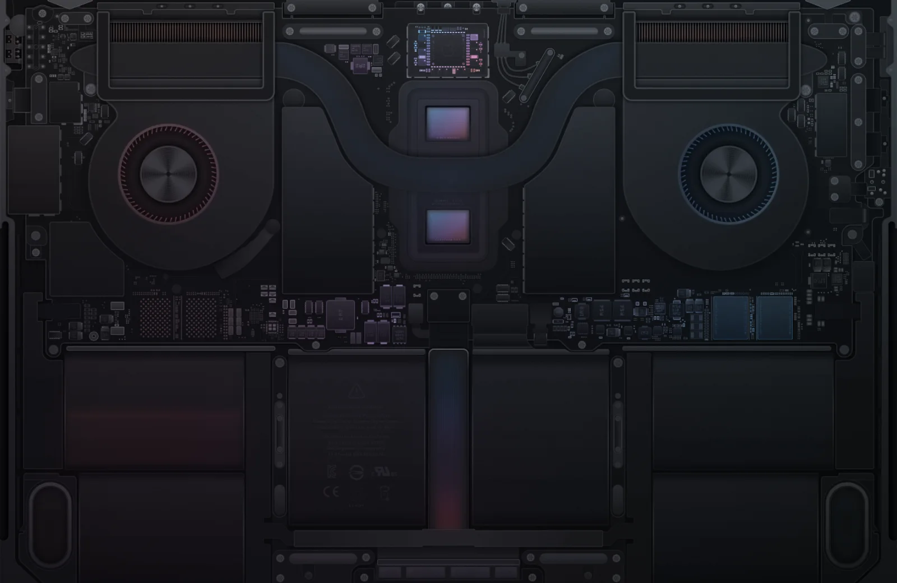

# Fond d'écran vivant, moteur WebGL (MacBook Pro et MacBook Air)

Une seule image sombre et monochrome de l'intérieur d'un MacBook Pro, colorisée et animée par le code (WebGL2) selon l'usage réel de la machine : CPU, GPU, mémoire, disque, réseau, batterie, audio, ventilateurs, chaleur.

Le fond est **purement passif** : il représente l'activité du Mac en temps réel, sans aucune interaction au clic, au survol ou à la molette (choix de l'utilisateur). Seul l'éditeur de zones (`?debug=1`) utilise la souris.



Autres captures dans [docs/pro-captures/](docs/pro-captures/) : les quatre thèmes au repos, l'état en charge, le rendu en direct pendant une boucle CPU et la superposition des zones sur l'image.

## Installation

```sh
npm install              # sharp, vite, vite-plugin-singlefile (déjà présents pour la version Air)
npm run prepare:pro      # génère les cartes de assets/pro/ depuis l'image source
npm run build:pro        # vérifie les types, construit dist-pro/ et dist-pro-single/
```

`prepare:pro` cherche l'image source (suffixe image_7) dans cet ordre : argument de la commande, variable `PRO_SOURCE`, `assets/pro/src/image_7.png`, la racine du projet, `~/Downloads`, `~/Desktop`. Une copie est faite dans `assets/pro/src/` ; l'original n'est jamais modifié.

## Lancement

### Application native (recommandé sur ce Mac, sans Plash)

Plash n'est pas installable sans identifiant Apple. Une petite application native (AppKit + WKWebView, compilée sur place sans Xcode) le remplace :

```sh
npm run app:pro          # compile et installe ~/Applications/MBP Wallpaper.app
open -a "MBP Wallpaper"
```

- Une fenêtre par écran, au niveau du bureau (sous les icônes), transparente aux clics.
- Elle démarre `server/telemetry-pro.mjs` (port 8788) s'il ne tourne pas déjà, et le relance en cas d'arrêt. Journal : `~/Library/Logs/MBP Wallpaper.log`.
- Menu (icône de ventilateur dans la barre des menus) : thème, sur tous les écrans, économie d'énergie (12 i/s), ouverture à l'ouverture de session (LaunchAgent `local.mbp-wallpaper.app`), recharger, éditeur de zones, quitter.
- **Cohabitation avec la version Air** : tant que « MBA Wallpaper » est ouverte, l'application Pro reste en pause sans fenêtre (deux fonds se superposeraient), et reprend automatiquement à la fermeture d'Air. Le menu propose « Utiliser le fond Pro (quitte MBA Wallpaper) » pour basculer.

### Développement

```sh
npm run telemetry:pro    # télémétrie sur http://localhost:8788 (sert aussi dist-pro/)
npm run dev:pro          # serveur Vite sur http://localhost:5174/pro.html (port strict)
```

### Plash (si disponible)

- Avec le serveur : `http://localhost:8788/pro.html` (build) ou `http://localhost:5174/pro.html` (développement).
- Sans serveur web : le fichier unique `dist-pro-single/pro.html` (images en base64, aucune texture chargée depuis `file://`). Il se connecte à `http://localhost:8788/telemetry` ; sans serveur, une simulation réaliste prend le relais.

## Paramètres d'URL

| Paramètre | Effet |
| --- | --- |
| `theme=rainbow\|warm\|sunset\|mono\|auto` | palette (défaut rainbow ; auto : warm le jour, rainbow la nuit) |
| `debug=1` | éditeur de zones |
| `telemetry=<url>\|sim\|off` | source des mesures (sim ou off : simulation locale) |
| `fps=10..60` | cadence au repos (défaut 60, synchronisée sur l'écran) |
| `quality=0.4..1` | résolution du canevas par rapport aux cartes |
| `gamma=0.5..1.5` | surcharge du gamma du profil |
| `motion=reduce` | force le mouvement réduit |
| `static=1` et `level=0..1` | image figée pour les captures, toutes les zones forcées au niveau donné |
| `parts=0` | désactive l'éclairage pièce par pièce des zones de carte (comparaison) |

## Principe du rendu

1. `scripts/prepare-pro-image.mjs` (sharp) produit dans `assets/pro/` : `lum.webp` (luminance), `detail.webp` (passe-haut signé, 128 = neutre), `edges.webp` (Sobel), `base.webp` (version couleur, largeur max 2880 px) et `meta.json` (points noir et blanc).
2. Au chargement, les trois cartes sont assemblées dans une seule texture RGBA mipmappée.
3. À chaque image (`src/pro/shaders.ts`) :
   - **champ** (1/4 de résolution) : couleur émissive de chaque zone selon son signal, son effet et la palette ;
   - **bloom** (1/4) : émissif x (détails + contours) puis flou gaussien séparable ;
   - **composition** (pleine résolution) : niveaux et gamma, gradient map de la luminance, rotation des ventilateurs, émissif appliqué sur les pistes et les arêtes (pas en aplat), bloom, grain, vignette.
4. Les palettes sont des rampes de couleurs dans une texture 256 x 8 (`src/pro/themes.ts`) : couleur de la carte de gauche à droite, spectre des puces, chaleur, ambiance, évacuation (orange puis rouge), alerte, jour.

## Zones et signaux

Le profil `profiles/pro.json` décrit chaque zone : forme (`rect`, `circle`, `path`, `frame`, polygone optionnel), effet visuel et signal. Coordonnées normalisées `[x0, x1, y0, y1]` ; les rayons et largeurs sont en fraction de la largeur de l'image.

| Zone | Signal | Réaction |
| --- | --- | --- |
| `die_top` | CPU (os.cpus, processus le plus actif, ligne de base adaptative) | émissif et teinte qui glisse du froid vers le chaud |
| `die_bottom` | GPU (ioreg IOAccelerator, « Device Utilization % ») | idem |
| `die_top_frame`, `die_bottom_frame` | pression mémoire (vm_stat) | lueur du cadre |
| `fan_left`, `fan_right` | régime des ventilateurs | rotation du disque, flou de rotation croissant, anneau lumineux |
| `vent_left`, `vent_right` | air chaud (chaleur x ventilation) | grilles orange puis rouge, scintillement montant |
| `heatpipe`, `heat_link` | chaleur simulée (intégration de la charge) | flux de chaleur des puces vers les ventilateurs |
| `heat_plate_*` | chaleur | chaleur montante |
| `power_left`, `power_right` | puissance (SystemLoad ou tension x courant) | vagues d'énergie qui affluent vers la puce |
| `nand` | E/S disque (iostat) | scintillement |
| `bat_*` (6 cellules) | niveau de batterie (pmset) | remplissage une à une, flux en charge, rouge si faible |
| `flex_center`, `trackpad`, `sensor_*` | activité globale | particules et lueur |
| `speaker_*` | lecture audio et volume | pulsation concentrique |
| `ports_*`, `magsafe` | adaptateur secteur | lueur, impulsion et onde au branchement |
| `control_top` | heure locale | chaud le jour, spectre la nuit |
| `network_cluster` | débit réseau (netstat -ib) | scintillement |

**Choix narratif** : les deux puces centrales ne sont pas identifiées avec certitude sur l'image. La puce du haut est traitée comme le CPU et celle du bas comme le GPU. L'attribution se change dans `profiles/pro.json` (`"narrative": { "die_top": "cpu", "die_bottom": "gpu" }`) ou dans l'éditeur.

Lissage côté client : montée rapide (0,35 s), descente lente (2,2 s). Ventilateurs : inertie de 1,5 s en accélération, 4 s en décélération.

## Réglage des zones (`?debug=1`)

Ouvrir `http://localhost:8788/pro.html?debug=1` (ou via le menu de l'application, ou sur le port 5174 en développement).

- Glisser une zone pour la déplacer ; poignées carrées pour la redimensionner ; poignées rondes jaunes pour le trou d'un cadre.
- Ventilateurs : poignées de rayon (ailettes, moyeu, carter).
- Chemins (caloduc, nappe) et polygones : glisser un sommet, cliquer un point milieu pour en ajouter, Alt + clic ou double-clic pour en retirer. Curseurs de largeur et d'origine du flux.
- Curseurs : intensité forcée de chaque zone (clic sur la valeur pour revenir à la télémétrie), régime des ventilateurs, thème, gamma, exposition, bloom, détails, contours, grain, vignette, attribution CPU / GPU.
- « Tester chaque zone » allume les zones une à une.
- « Exporter » réécrit `profiles/pro.json` via le serveur (`POST /__profile-pro`) ; sans serveur, le fichier est téléchargé. Relancer `npm run build:pro` pour le build statique et l'application.
- Clavier : flèches (Maj x10), H masque le panneau, Z masque les zones, Échap désélectionne.

## Mode powermetrics

```sh
sudo node server/telemetry-pro.mjs --powermetrics
```

Lit `powermetrics --samplers smc,cpu_power,gpu_power` : vraie vitesse des ventilateurs (si l'échantillonneur smc existe) et puissances CPU / GPU, affichées dans l'éditeur. Sur la plupart des Mac Apple Silicon, l'échantillonneur smc n'existe pas : le serveur relance alors powermetrics avec `cpu_power,gpu_power` seulement et garde l'estimation du régime. Bornes de régime : variables `FAN_MIN_RPM` et `FAN_MAX_RPM`.

Sans ce mode, le régime est **estimé** : charge CPU + GPU lissée sur 20 s (un processus qui sature un cœur compte, même noyé dans la moyenne) et pression thermique (`pmset -g therm`).

## Sobriété énergétique

- 60 i/s synchronisées sur l'écran (une image sur deux sur un écran ProMotion 120 Hz, à intervalle constant), 12 i/s en économie d'énergie, 4 i/s en mouvement réduit (`prefers-reduced-motion`), arrêt complet quand la page est masquée (y compris le flux SSE).
- Le serveur arrête d'échantillonner 10 s après le départ du dernier client.
- devicePixelRatio plafonné à 2, et résolution plafonnée à celle des cartes (2880 px).
- Au repos, le champ émissif et le bloom ne sont recalculés qu'une image sur deux.

Mesures (Chrome headless, build de production, M4 Pro) : environ 7 à 9 % d'un cœur au repos à 24 i/s (dont environ 5 % pour le processus GPU de Chrome, qui présente chaque image), environ 5 % à 12 i/s, environ 3 % en mouvement réduit. Le serveur de télémétrie coûte moins de 1 %. **L'objectif de 5 % n'est donc pas atteint à 24 i/s** dans ces mesures ; l'option « Économie d'énergie » de l'application (12 i/s) s'en approche. **Mesure dans le vrai WKWebView** (application MBP Wallpaper, écran Retina 120 Hz, après le passage à 60 i/s) : environ 21 à 27 % d'un cœur au total selon les mesures (WebContent 5 %, processus GPU 11 à 17 %, application 5 %) ; l'écart vient du processus GPU de WebKit, à code identique. C'est le prix de la fluidité ; l'option « Économie d'énergie » (12 i/s) reste disponible.

## Limites connues

- Pas d'interaction souris dans le fond (voulu). Plash, de toute façon, ne transmet pas la souris en mode normal.
- Régime des ventilateurs estimé sans droits administrateur (pas d'accès SMC sur Apple Silicon).
- Les cadences de 30 i/s et plus suivent la synchronisation de l'écran (requestAnimationFrame) ; les cadences plus basses (économie d'énergie) passent par un minuteur et peuvent être moins régulières.
- Les applications Air et Pro ne doivent pas afficher leur fond en même temps : l'application Pro se met en pause d'elle-même, mais l'application Air n'a pas d'équivalent.
- Le profil exporté n'est pris en compte par l'application qu'après `npm run build:pro` (elle sert le build).

## Fichiers

`pro.html`, `src/pro/` (moteur, shaders, signaux, simulation, éditeur), `profiles/pro.json`, `assets/pro/`, `scripts/prepare-pro-image.mjs`, `scripts/build-masks.mjs`, `scripts/build-parts.mjs`, `scripts/build-mac-pro-app.sh`, `mac-pro/`, `server/telemetry-pro.mjs`, `server/profile-pro-io.mjs`, `vite.pro.config.ts`, `tsconfig.pro.json`. Voir aussi [docs/HANDOFF-PRO.md](docs/HANDOFF-PRO.md).

## Refonte visuelle (look « graphite et aurore »)

Le premier rendu avait un aspect un peu rétro, « Matrix » : dominante olive, circuits néon jaunes et verts, motifs numériques. La refonte :

- **Palette** : couleurs système d'Apple (corail, rose, violet, indigo, bleu, cyan), plus de jaune ni de vert phosphore ; fond graphite neutre légèrement froid.
- **Lumière sur les surfaces** plutôt que sur les arêtes : `detail` 0,4 et `edges` 0,3 dans le profil, contribution des surfaces renforcée dans la composition ; plus de lueur ambiante teintée (`ambientGlow` à 0), qui colorait toutes les pistes.
- **Plus de motifs numériques** : stockage et réseau miroitent doucement (bruit continu) au lieu de clignoter par blocs, plaques et batteries ondulent lentement au lieu de rayures, la nappe porte un flux lumineux continu : deux couches de bruit lisse glissent vers le bas à des vitesses différentes et se fondent l'une dans l'autre, sans paquets ni bord net.
- **Bloom plus large** (trois passes de flou) et **aurore** (`aurora` dans le profil) : deux lumières colorées très douces venues des coins, qui dérivent lentement et éclairent le métal.
- **Grain réduit** à un simple tramage anti-bandes.

## Moteur commun Air et Pro

Le moteur WebGL sert désormais les deux machines. Chaque page déclare son « appareil » (`src/pro/device.ts`) avant de charger le moteur :

| | MacBook Pro | MacBook Air |
|---|---|---|
| Page | `pro.html` (`src/pro/entry-pro.ts`) | `air.html` (`src/pro/entry-air.ts`) |
| Profil de zones | `profiles/pro.json` (31 zones, ventilateurs, caloduc) | `profiles/air.json` (17 zones, pas de ventilateur) |
| Cartes d'image | `assets/pro/` (image_7) | `assets/air/` (base-dark, image_13) |
| Application | MBP Wallpaper | MBA Wallpaper |

```sh
npm run build:air && npm run app        # MacBook Air
npm run build:pro && npm run app:pro    # MacBook Pro
```

Les deux pages sont servies par le même serveur (`server/telemetry-pro.mjs`, port 8788), partagé par les deux applications. MBP Wallpaper s'efface tant que MBA Wallpaper tourne (vérification toutes les 2 s : macOS ne publie pas les notifications de lancement pour les applications sans icône dans le Dock).

L'ancienne version Air en Canvas 2D (`index.html`, calques pré-colorés par l'auteur) reste disponible : voir [README-AIR.md](README-AIR.md).

## Masques de forme

Les zones du profil sont des formes géométriques ; les composants réels ont des coins arrondis, des encoches, des formes libres. `scripts/build-masks.mjs` (lancé par `npm run build:pro` et `build:air`, ou `npm run masks`) découpe la forme réelle de chaque zone marquée `refine` dans l'image :

- `"refine": "fill"` : croissance de proche en proche depuis le cœur de la zone (ou depuis la ligne centrale d'un chemin), qui suit les dégradés et s'arrête sur les contours nets (contours épaissis d'un pixel pour boucher les brèches). Les petites régions parasites sont écartées, les trous (textes imprimés) bouchés. Seuil réglable par zone : `"refineEdge"` (28 par défaut).
- `"refine": "silhouette"` : tout ce qui se détache du fond sombre (carte chargée de composants), trous bouchés, plus grande région.
- `"maskOf": "<zone>"` : emprunte le masque d'une autre zone (la diffusion de chaleur de l'Air reste dans la plaque).

Le résultat (`assets/<appareil>/zones-mask.png`, un identifiant de zone par canal RGB, trois superpositions possibles) est lu par le shader du champ lumineux avec quatre échantillons par pixel. Un masque n'est utilisé que si la géométrie de sa zone n'a pas changé depuis son calcul : après une modification dans l'éditeur, relancez `npm run masks`. Option `--preview fichier.png` pour contrôler le découpage.

## Pièces des zones de carte

Une zone marquée `"parts": true` (Pro : alimentations, stockage, réseau, contrôleur ; Air : carte mère, étage d'alimentation, stockage, Wi-Fi) n'éclaire plus une surface : seules ses pièces s'allument, le circuit imprimé nu entre elles reste sombre. `scripts/build-parts.mjs` (lancé par `npm run masks`) détecte les pièces dans l'image à pleine résolution :

- une pièce est ce qui dépasse nettement le fond du circuit (luminance la plus fréquente de la moitié sombre de la zone ; là où des zones se chevauchent, la plus grande impose ce seuil) ;
- le corps d'une puce sombre est bouché (intérieur d'un contour fermé), les pistes fines sont supprimées ;
- ne sont pas retenus : les cadres métalliques, les formes filiformes ou très allongées (bords de carte), les pièces coupées par le bord de la zone (une marge de détection garde entière une pièce dont le centre est dans la zone) ;
- les zones non marquées qui chevauchent une zone de carte (puce principale, connecteur) gardent leur rendu.

Résultat : environ 900 pièces sur la Pro, 2 000 sur l'Air, dans `assets/<appareil>/zones-parts.png` (pleine résolution, une couleur codée par pièce : coordonnées de son centre). Le moteur lit la lumière au centre de chaque pièce : une puce, une bille BGA ou une self s'allume d'un bloc, sans dégradé de zone, et les effets (vagues de l'alimentation, scintillement du stockage) passent de pièce en pièce. L'alpha des cartes vaut 0 sur le circuit nu : ni lumière ni halo n'y tombent, le halo suit la densité de pièces. Comme pour les masques, les pièces sont ignorées si une zone de carte a été modifiée dans l'éditeur depuis leur calcul (relancer `npm run masks`). Coût mesuré : nul à la précision de la mesure (même consommation avec `?parts=0`).

## Premier plan et fondus

- `"above": true` (caloduc) : la forme de la zone, réelle si elle a un masque, masque la lumière des zones situées dessous. Sans cela, la lueur des boîtiers traversait le tube.
- Les fondus sont entièrement intérieurs : la lumière s'estompe avant le bord et ne sort jamais de sa zone. Les zones qui éclairent une portion de carte (alimentation, stockage, réseau) ont un fondu large (0,022).
- Les extrémités d'un chemin sont arrondies et dépassent de sa demi-largeur : le départ d'une nappe est reculé d'autant pour coïncider avec l'arrondi réel du câble.
- Les nappes ont leur propre masque. En bas, la nappe Pro s'arrête net contre la barre du châssis (son extrémité arrondie, qui débordait sur la barre, est coupée par le masque) ; celle de l'Air se termine là où le câble s'estompe dans l'image, avant la petite carte de connexion.

## Alimentation et nappe : des flux continus

- **Alimentation** : des vagues larges partent du bord opposé et avancent vers la puce principale (sens calculé d'après la position de la puce de chaque Mac), à la vitesse de la puissance consommée, en se renforçant à son approche : la lumière alimente la puce. Ce sont des vagues continues (cosinus) : l'ancienne bande repartait du bord à chaque cycle, d'où un saut visible, amplifié par l'éclairage pièce par pièce. Les deux alimentations de la Pro envoyaient en outre leur lumière vers l'extérieur.
- **Nappe** : un flux lumineux continu (deux couches de bruit lisse qui glissent à des vitesses différentes) remplace les comètes, dont l'avant était coupé net.

## Transitions

Les niveaux suivent un amortissement critique (ressort sans rebond) : accélération puis décélération, montée en environ 1 s, descente en environ 2 s, au lieu d'un lissage exponentiel qui démarrait sèchement. Les impulsions s'éteignent en 0,9 s.

