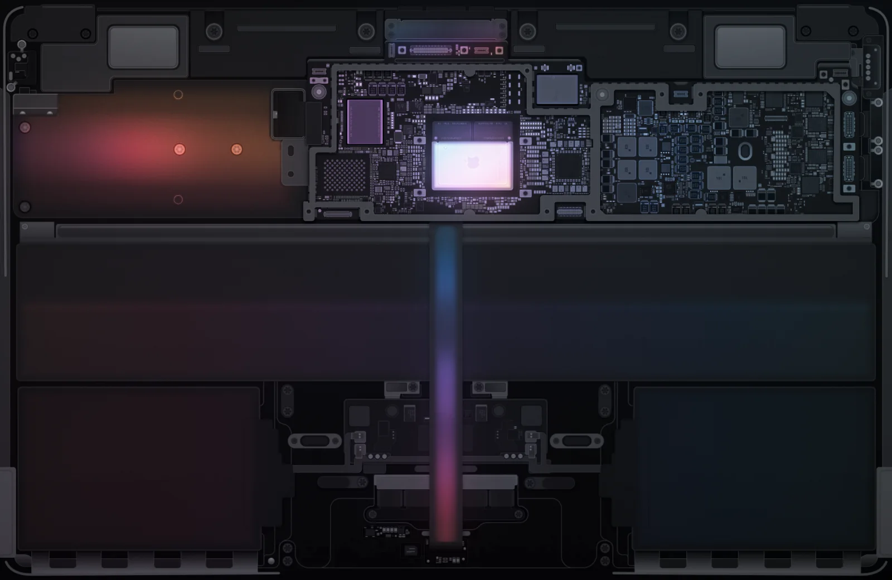
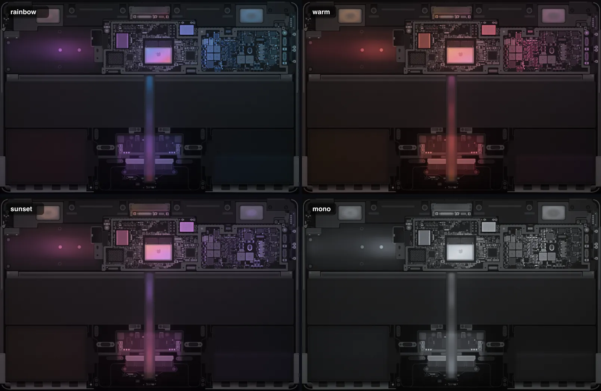
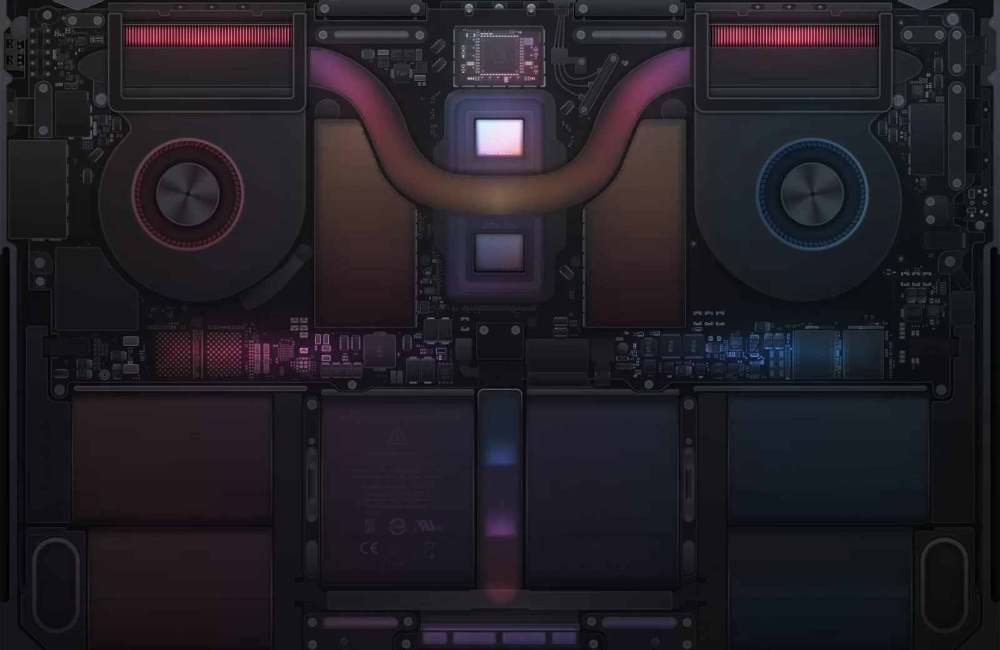

<div align="center">

# MacBook Internals · Live Wallpaper

[English](README.md) · **Français**

**Un fond d'écran macOS qui montre l'intérieur de votre Mac… et le fait vivre au rythme de ce qu'il fait vraiment.**

La puce s'embrase quand le processeur travaille, la batterie se remplit avec la charge, les ondes Wi-Fi suivent le débit, les ventilateurs accélèrent quand ça chauffe.



<sub>Version MacBook Air capturée pendant une vraie boucle CPU. Illustration originale : <a href="https://www.basicappleguy.com/basicappleblog/m4-macbook-air-internals-13-inch">Basic Apple Guy</a>.</sub>

</div>

---

> [!IMPORTANT]
> **Les illustrations ne sont pas de moi.** Les magnifiques vues intérieures des MacBook sont l'œuvre de **[Basic Apple Guy](https://www.basicappleguy.com)**, qui publie depuis des années des fonds d'écran « internals » d'une précision remarquable. Tout est parti de son article **[iPhone 17 Pro Internals Wallpapers](https://basicappleguy.com/basicappleblog/iphone-17-pro-internals-wallpapers)** et de ses séries [MacBook Air 13 pouces](https://www.basicappleguy.com/basicappleblog/m4-macbook-air-internals-13-inch) et [MacBook Pro 14 et 16 pouces](https://www.basicappleguy.com/basicappleblog/macbook-pro-2025-update).
>
> Ce projet n'ajoute que le code qui les anime. Si vous aimez le résultat, allez voir son blog, et **soutenez son travail** en achetant ses packs : c'est lui qui rend tout ça possible.

---

## Deux Mac, un seul moteur

Les deux versions tournent sur le même moteur **WebGL2** : une seule image sombre de l'intérieur du Mac, colorisée et animée par des shaders. Son style est « graphite et aurore » : métal graphite neutre, couleurs système d'Apple (corail, rose, violet, indigo, bleu, cyan), lumière douce et diffuse, et deux lueurs colorées très légères qui dérivent depuis les coins. Il tourne à 60 images par seconde, en phase avec l'écran.

<table>
<tr>
<td width="50%" valign="top">

### MacBook Air


- Sans ventilateur, comme le vrai : la chaleur diffuse de la puce vers la plaque
- 3 cellules de batterie, nappe, grilles de haut-parleurs, Taptic Engine

</td>
<td width="50%" valign="top">

### MacBook Pro


- Ventilateurs qui tournent selon la charge, avec un lissage sur 20 s
- Caloduc qui chauffe des puces vers les ailettes

</td>
</tr>
</table>

**La lumière reste à sa place.** Les vrais composants ont des coins arrondis, des encoches et des contours libres : chaque zone est donc limitée à la forme réelle de sa pièce, découpée dans l'image elle-même. La lumière ne déborde jamais sur les pièces voisines. Le caloduc passe devant les boîtiers des puces et masque leur lueur, comme dans la vraie machine. [Documentation du moteur →](README-PRO.md)

La version MacBook Air d'origine, dessinée en Canvas 2D à partir des sept calques pré-colorés par l'auteur, reste disponible en mode « classique » : [documentation →](README-AIR.md)

## Ce qui s'allume, et pourquoi

Tout est mesuré **localement**, en temps réel, par un petit serveur Node.js sans aucune dépendance.

| Composant | Ce qu'il reflète | Source macOS |
|---|---|---|
| 🧠 Puce (CPU / GPU) | Charge processeur et graphique, de la teinte froide à l'incandescence | `os.cpus()`, `ps`, `ioreg IOAccelerator` |
| 💾 Mémoire / stockage | Pression mémoire, scintillement selon les entrées / sorties disque | `vm_stat`, `iostat` |
| ⚡ Étage d'alimentation | Puissance consommée par le système, en watts | `ioreg AppleSmartBattery` |
| 🔋 Batteries | Niveau de charge, flux animé pendant la charge, alerte sous 20 % | `pmset -g batt` |
| 🔥 Plaque, caloduc, ventilateurs | Pression thermique et charge soutenue | `pmset -g therm`, `notifyutil` |
| 🔊 Haut-parleurs | Pulsation pendant la lecture audio, selon le volume | `pmset -g assertions`, `osascript` |
| 📶 Wi-Fi / Bluetooth | Débit réseau | `netstat -ib` |
| ⌨️ Trackpad / Taptic Engine | Votre activité au clavier et au trackpad, dans toutes les apps | `ioreg IOHIDSystem` |
| 🔌 Ports | Branchement du secteur | `pmset`, `ioreg` |
| 🖥️ Connecteur d'écran | Jour et nuit, selon l'heure locale | horloge |

Le fond est **entièrement passif** : il ne réagit ni aux clics ni au survol. Il se contente de raconter ce que fait votre Mac.

> Petite astuce de conception : une boucle infinie n'occupe qu'un cœur, soit 8 % de la moyenne sur une puce à 12 cœurs, noyée dans le bruit du repos. La puce surveille donc aussi le processus le plus gourmand et l'excédent par rapport à votre propre ligne de base. Résultat : `while :; do :; done` dans un Terminal suffit à l'embraser en 3 à 5 secondes.

## Démarrage rapide

Prérequis : macOS 13 ou plus récent, [Node.js](https://nodejs.org) 20 ou plus récent, et les outils en ligne de commande d'Apple (`xcode-select --install`). **Pas besoin de Xcode, ni de compte Apple, ni de droits administrateur.**

```sh
git clone https://github.com/trichard-coder/macbook-internals-live-wallpaper.git
cd macbook-internals-live-wallpaper
npm install
```

**Version MacBook Air**

```sh
npm run build:air    # construit les pages et les masques de forme
npm run app          # compile et installe ~/Applications/MBA Wallpaper.app
open -a "MBA Wallpaper"
```

**Version MacBook Pro**

```sh
npm run build:pro
npm run app:pro      # compile et installe ~/Applications/MBP Wallpaper.app
open -a "MBP Wallpaper"
```

Une icône apparaît dans la barre des menus : thème, écrans, économie d'énergie (12 images par seconde), lancement à l'ouverture de session, quitter. L'application lance et surveille elle-même le serveur de télémétrie, inutile de garder un Terminal ouvert. Les deux applications se laissent la place : une seule affiche son fond à la fois.

<details>
<summary><b>Pourquoi une application maison plutôt que Plash ?</b></summary>

<br>

[Plash](https://sindresorhus.com/plash) est l'outil classique pour afficher une page web en fond d'écran, mais il n'est distribué que sur l'App Store, ce qui exclut les Mac sans identifiant Apple (souvent les Mac professionnels). Le projet embarque donc un remplaçant minimal (`mac/main.swift`, environ 250 lignes) : une fenêtre par écran placée au niveau du bureau, sous les icônes, transparente aux clics, qui affiche la page dans un WKWebView. Elle se compile sur place avec `swiftc`.

Si vous avez Plash, il fonctionne aussi : lancez `npm run telemetry:pro` (port 8788), puis ajoutez `http://localhost:8788/air.html` ou `http://localhost:8788/pro.html` dans Plash.

</details>

## Thèmes et réglages

Choisissez le thème depuis le menu de l'application, ou par paramètre d'URL :

| Thème | Ambiance |
|---|---|
| `rainbow` | Arc-en-ciel saturé, du froid au chaud (par défaut) |
| `warm` | Orange, magenta et violet |
| `sunset` | Ambre et pourpre |
| `mono` | Aucune couleur, simple éclaircissement |
| `auto` | `warm` le jour, `rainbow` la nuit |

D'autres paramètres permettent de régler la cadence (`?fps=`), la résolution (`?quality=`) ou de réduire les animations (`?motion=reduce`, également activé par le réglage d'accessibilité de macOS). Le mode `?debug=1` ouvre un **éditeur de zones** pour ajuster au pixel près la position de chaque composant.

## Comment ça marche

```
 commandes macOS                serveur Node.js               page web                  application native
 (ioreg, pmset, vm_stat,  ──▶   127.0.0.1, sans      ──SSE──▶  moteur WebGL2      ──▶   fenêtre au niveau
  netstat, iostat, ps...)       dépendance, 1 Hz              air.html / pro.html       du bureau (WKWebView)
```

- **Respect de la vie privée** : le serveur n'écoute que sur `127.0.0.1` et n'accepte que les pages locales. Aucune donnée ne quitte votre Mac.
- **Robuste** : une mesure qui échoue est remplacée par une simulation réaliste, champ par champ. Sans serveur, la page simule tout.
- **Fluide** : 60 images par seconde en phase avec l'écran, et chaque changement accélère puis ralentit (amortissement critique), sans à-coup. Tout s'arrête quand la page est masquée.

## État actuel, en toute transparence

- ✅ Mesures réelles, réaction à la charge, thèmes, éditeur de zones, applications natives.
- ⚠️ **Consommation** : la fluidité a un coût. Mesurée dans l'application réelle à 60 images par seconde, chaque version consomme environ 21 à 22 % d'un cœur (contenu web, processus GPU et application réunis). L'option « Économie d'énergie » du menu (12 images par seconde) ou `?quality=0.75` la réduisent nettement.
- Testé sur un MacBook Pro 14 pouces M4 Pro sous macOS 26.

## Structure

```
mac/, mac-pro/            applications de fond d'écran (Swift, AppKit + WKWebView)
server/                   serveurs de télémétrie (Node.js, sans dépendance)
src/pro/                  moteur WebGL2 commun aux deux Mac (air.html, pro.html)
profiles/                 zones et réglages (air.json, pro.json)
assets/air/, assets/pro/  images, cartes dérivées et masques de forme
scripts/                  préparation des images, masques de forme, compilation des applications
src/, assets/opt/         version Air classique (Canvas 2D, index.html)
docs/                     captures
```

## Crédits et licence

- **Illustrations** : © [Basic Apple Guy](https://www.basicappleguy.com). Elles sont reproduites ici avec attribution, uniquement pour faire fonctionner le projet, et **ne sont pas couvertes par la licence du code**. Pour les utiliser ailleurs, rendez-vous sur [son blog](https://basicappleguy.com/basicappleblog/iphone-17-pro-internals-wallpapers). Si l'auteur souhaite leur retrait, il sera fait sans discussion.
- **Code** : licence [MIT](LICENSE).
- Projet indépendant, sans aucun lien avec Apple Inc. MacBook, MacBook Air et MacBook Pro sont des marques d'Apple Inc.
