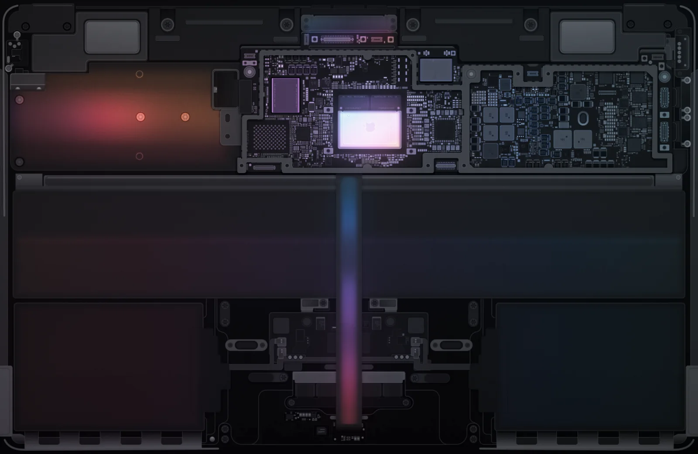
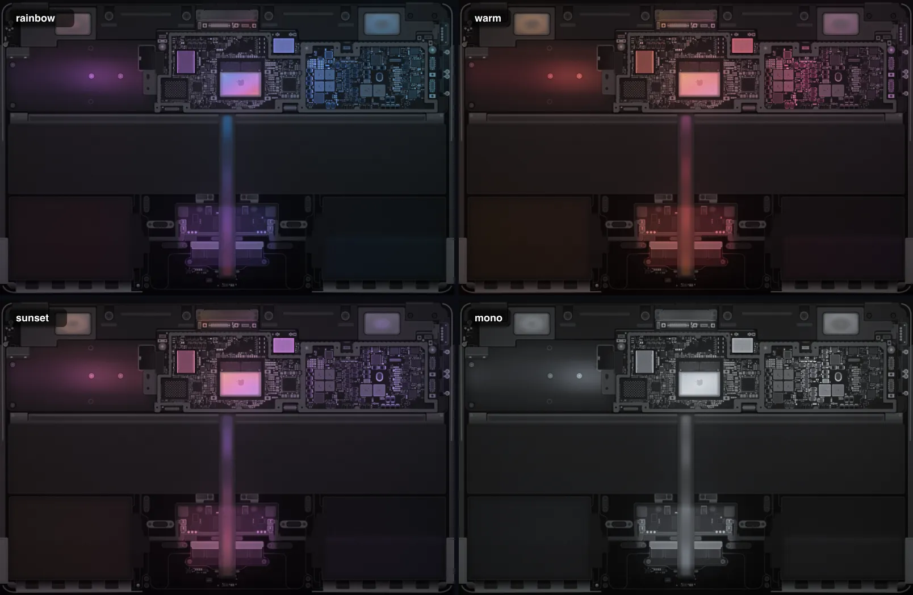
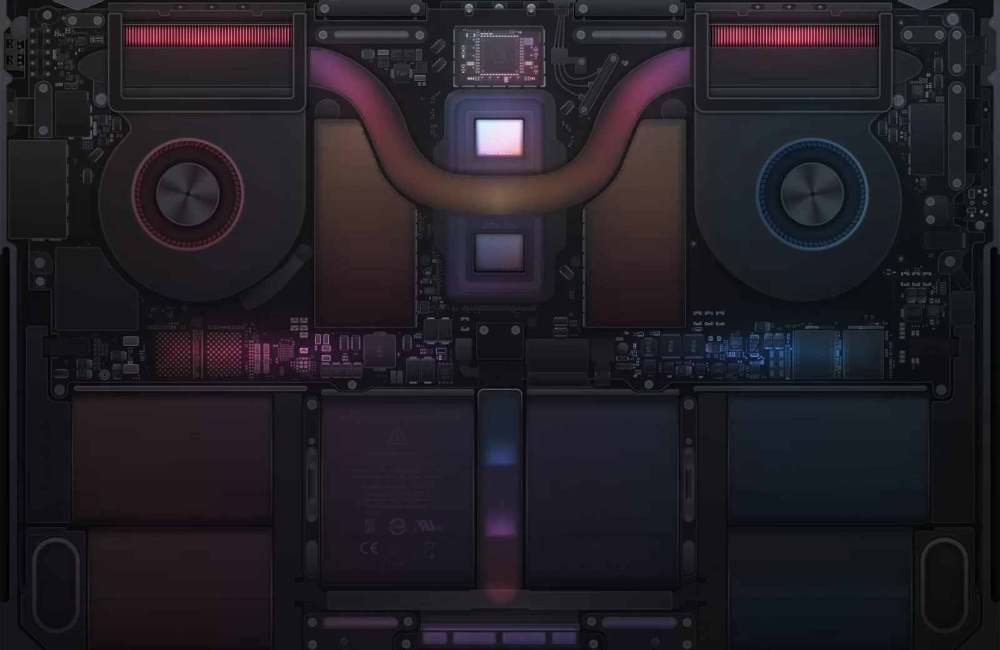

<div align="center">

# MacBook Internals · Live Wallpaper

**English** · [Français](README.fr.md)

**A macOS wallpaper that shows the inside of your Mac… and brings it to life with what your Mac is actually doing.**

The chip glows when the CPU works hard, the battery fills with your charge level, Wi-Fi waves follow your throughput, and the fans spin up when things get hot.



<sub>MacBook Air version, captured during a real CPU loop. Original artwork by <a href="https://www.basicappleguy.com/basicappleblog/m4-macbook-air-internals-13-inch">Basic Apple Guy</a>.</sub>

</div>

---

> [!IMPORTANT]
> **The artwork is not mine.** These beautiful MacBook internals illustrations are the work of **[Basic Apple Guy](https://www.basicappleguy.com)**, who has been publishing remarkably detailed "internals" wallpapers for years. This project started from his post **[iPhone 17 Pro Internals Wallpapers](https://basicappleguy.com/basicappleblog/iphone-17-pro-internals-wallpapers)** and his [13-inch MacBook Air](https://www.basicappleguy.com/basicappleblog/m4-macbook-air-internals-13-inch) and [14 and 16-inch MacBook Pro](https://www.basicappleguy.com/basicappleblog/macbook-pro-2025-update) series.
>
> This project only adds the code that animates them. If you enjoy the result, visit his blog and **support his work** by buying his wallpaper packs: he is the one who makes all of this possible.

---

## Two Macs, one engine

Both versions run on the same **WebGL2** engine: a single dark image of the Mac's internals, colorized and animated by shaders. Its look is "graphite and aurora": neutral graphite metal, Apple system colors (coral, pink, purple, indigo, blue, cyan), soft diffuse light and two faint colored glows drifting in from the corners. It runs at 60 frames per second, in sync with the display.

<table>
<tr>
<td width="50%" valign="top">

### MacBook Air


- Fanless, like the real one: heat spreads from the chip into the plate
- 3 battery cells, flex cable, speaker grilles, Taptic Engine

</td>
<td width="50%" valign="top">

### MacBook Pro


- Fans spin with the load, smoothed over 20 seconds
- The heat pipe warms up from the chips to the fins

</td>
</tr>
</table>

**Light stays where it belongs.** Real components have rounded corners, notches and free-form outlines, so each zone is clipped to the actual shape of its part, cut out of the image itself. The light never spills onto neighboring parts. The heat pipe sits in front of the chip packages and hides their glow, as it does in the real machine.

**Part by part.** On the logic boards, no area lights up as a block: about 900 parts on the Pro and 2,000 on the Air (chips, BGA balls, resistors, inductors) are detected in the image, and each one lights up as a whole while the bare circuit board around them stays dark. Energy waves flow from the power stages toward the chip at the pace of the measured power draw, and the storage shimmer travels from part to part. [Engine documentation (French) →](README-PRO.md)

The original MacBook Air version, drawn in Canvas 2D from the artist's seven pre-colored layers, is still available as a "classic" mode: [documentation (French) →](README-AIR.md)

## What lights up, and why

Everything is measured **locally**, in real time, by a small dependency-free Node.js server.

| Component | What it reflects | macOS source |
|---|---|---|
| 🧠 Chip (CPU / GPU) | Processor and graphics load, from a cool tint to incandescence | `os.cpus()`, `ps`, `ioreg IOAccelerator` |
| 💾 Memory / storage | Memory pressure, flickering with disk I/O | `vm_stat`, `iostat` |
| ⚡ Power stage | System power draw, in watts | `ioreg AppleSmartBattery` |
| 🔋 Batteries | Charge level, animated flow while charging, alert below 20 % | `pmset -g batt` |
| 🔥 Plate, heat pipe, fans | Thermal pressure and sustained load | `pmset -g therm`, `notifyutil` |
| 🔊 Speakers | Pulses while audio is playing, scaled by volume | `pmset -g assertions`, `osascript` |
| 📶 Wi-Fi / Bluetooth | Network throughput | `netstat -ib` |
| ⌨️ Trackpad / Taptic Engine | Your keyboard and trackpad activity, in every app | `ioreg IOHIDSystem` |
| 🔌 Ports | Power adapter plugged in | `pmset`, `ioreg` |
| 🖥️ Display connector | Day and night, based on local time | clock |

The wallpaper is **fully passive**: it does not react to clicks or hovering. It simply tells the story of what your Mac is doing.

> A small design trick: an infinite loop only keeps one core busy, which is 8 % of the average on a 12-core chip, lost in the idle noise. So the chip also watches the busiest process and the excess load over your Mac's own baseline. As a result, running `while :; do :; done` in a Terminal is enough to make it glow within 3 to 5 seconds.

## Quick start

Requirements: macOS 13 or later, [Node.js](https://nodejs.org) 20 or later, and Apple's command line tools (`xcode-select --install`). **No Xcode, no Apple ID and no admin rights needed.**

```sh
git clone https://github.com/trichard-coder/macbook-internals-live-wallpaper.git
cd macbook-internals-live-wallpaper
npm install
```

**MacBook Air version**

```sh
npm run build:air    # builds the pages and the shape masks
npm run app          # compiles and installs ~/Applications/MBA Wallpaper.app
open -a "MBA Wallpaper"
```

**MacBook Pro version**

```sh
npm run build:pro
npm run app:pro      # compiles and installs ~/Applications/MBP Wallpaper.app
open -a "MBP Wallpaper"
```

An icon appears in the menu bar: theme, displays, power saving (12 frames per second), launch at login, quit. The app starts and watches the telemetry server by itself, so there is no need to keep a Terminal open. The Pro app steps aside while the Air app is running, so only one wallpaper is shown at a time.

<details>
<summary><b>Why a custom app instead of Plash?</b></summary>

<br>

[Plash](https://sindresorhus.com/plash) is the usual tool for showing a web page as your wallpaper, but it is only distributed through the App Store, which rules out Macs without an Apple ID (often work computers). The project therefore ships a minimal replacement (`mac/main.swift`, about 250 lines): one window per display, placed at desktop level, below the icons and click-through, showing the page in a WKWebView. It is compiled on your Mac with `swiftc`.

If you do have Plash, it works too: run `npm run telemetry:pro` (port 8788), then add `http://localhost:8788/air.html` or `http://localhost:8788/pro.html` in Plash.

</details>

## Themes and settings

Pick a theme from the app menu, or with a URL parameter:

| Theme | Mood |
|---|---|
| `rainbow` | Saturated rainbow, from cool to hot (default) |
| `warm` | Orange, magenta and purple |
| `sunset` | Amber and crimson |
| `mono` | No color, just brightening |
| `auto` | `warm` during the day, `rainbow` at night |

Other parameters adjust the frame rate (`?fps=`), the resolution (`?quality=`) or reduce animations (`?motion=reduce`, also enabled by the macOS accessibility setting). The `?debug=1` mode opens a **zone editor** to fine-tune the position of each component down to the pixel.

## How it works

```
 macOS commands                 Node.js server                web page                  native app
 (ioreg, pmset, vm_stat,  ──▶   127.0.0.1, no        ──SSE──▶  WebGL2 engine      ──▶   desktop-level window
  netstat, iostat, ps...)       dependencies, 1 Hz            air.html / pro.html       (WKWebView)
```

- **Privacy first**: the server only listens on `127.0.0.1`, only answers requests addressed to `localhost` (which blocks DNS rebinding) and only accepts local pages. Pages without an origin (`file://`) get the measurements but not the name of the busiest process, and can never change settings. No data ever leaves your Mac.
- **Resilient**: any measurement that fails is replaced, field by field, by a realistic simulation. Without a server, the page simulates everything.
- **Smooth**: 60 frames per second in sync with the display, and every change eases in and out (critically damped), with no sudden jumps. Everything stops when the page is hidden.

## Current status, honestly

- ✅ Real measurements, reaction to load, themes, zone editor, native apps.
- ⚠️ **Power use**: smoothness has a cost. Measured in the real app at 60 frames per second, each version uses about 21 to 27 % of one CPU core depending on the measurement (web content, GPU process and app combined). The "Power saving" menu option (12 frames per second) or `?quality=0.75` reduce it noticeably.
- Tested on a 14-inch MacBook Pro (M4 Pro) running macOS 26.

## Project layout

```
mac/, mac-pro/            wallpaper apps (Swift, AppKit + WKWebView)
server/                   telemetry servers (Node.js, no dependencies)
src/pro/                  WebGL2 engine shared by both Macs (air.html, pro.html)
profiles/                 zones and settings (air.json, pro.json)
assets/air/, assets/pro/  images, derived maps and shape masks
scripts/                  image preparation, shape masks, app compilation
src/, assets/opt/         classic Air version (Canvas 2D, index.html)
docs/                     screenshots
```

## Credits and license

- **Artwork**: © [Basic Apple Guy](https://www.basicappleguy.com). It is reproduced here with attribution, only so that the project works out of the box, and it is **not covered by the code license**. To use it elsewhere, head to [his blog](https://basicappleguy.com/basicappleblog/iphone-17-pro-internals-wallpapers). If the author asks for it to be removed, it will be, no questions asked.
- **Code**: [MIT](LICENSE) license.
- Independent project, not affiliated with Apple Inc. in any way. MacBook, MacBook Air and MacBook Pro are trademarks of Apple Inc.
